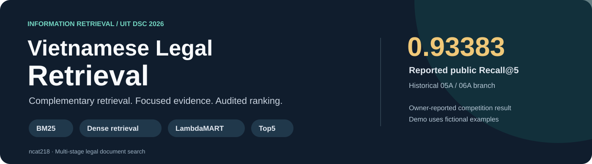
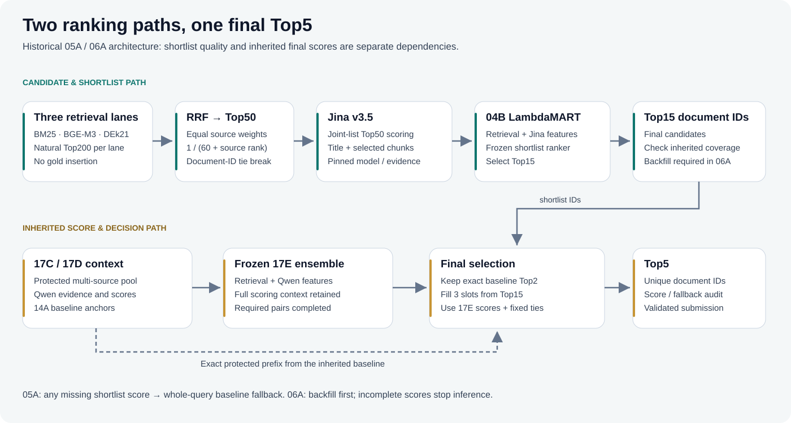

<p align="center"></p>

<p align="center">
  <a href="https://github.com/ncat218/vietnamese-legal-retrieval/actions/workflows/tests.yml"></a>
  
  
  
</p>

**A multi-stage system for finding the five most relevant Vietnamese legal documents for a question.** Built during UIT DSC 2026, this project studies how lexical retrieval, dense retrieval, evidence selection and learned ranking work together—and where they fail.

**Reported historical public Recall@5: 0.93383, on the 05A/06A research branch.** This is an owner-reported competition result, not a score reproduced by the lightweight demo in this repo. [Result provenance →](results/README.md)

**[Read the solution write-up](docs/solution.md)** · **[Run the project](docs/reproduce.md)** · **[Architecture](#the-solution)** · **[Tiếng Việt](docs/README.vi.md)**

## The problem

A Vietnamese legal question may refer to a concept, exception or legal relationship without using the exact words in the relevant article. Documents are long, many provisions have similar wording, and the final output has only five slots.

The useful distinction is between **finding relevant candidates** and **selecting the right five**. A high-recall candidate pool still loses correct documents during compression and final ranking.

## The solution



1. **Retrieve complementary candidates.** BM25, BGE-M3 and DEk21-v2 each contribute natural Top200 results. Equal-weight reciprocal-rank fusion produces D5 Top50.
2. **Read focused evidence.** Select query-relevant short chunks without using gold labels. Jina v3.5 jointly scores each complete Top50 list; a first LambdaMART model selects Top15.
3. **Preserve a strong baseline.** Keep the inherited baseline's first two documents, then fill the remaining slots from Top15 using frozen 17E retrieval/Qwen/LambdaMART scores. The two anchors may sit outside Top15.
4. **Handle missing scores explicitly.** The 05A pilot falls back to the entire baseline Top5 if any shortlist score is missing. 06A backfills missing Qwen pairs and rebuilds features in the appropriate scoring context before selection.

The final stage is a **bridge between two ranking systems**. Its full dependency graph matters: the final score is not simply Jina's raw score or a new LambdaMART trained on Top15.

## Results and what they mean

| Public leaderboard, historical owner-reported | Recall@5 |
|---|---:|
| D5 → Jina + LambdaMART direct Top5 (04C) | 0.909833334 |
| Inherited Qwen-feature LambdaMART baseline (17E) | 0.9332 |
| Top15 bridge, cache-safe pilot (05A) | **0.933833334** |
| Missing-pair backfill bridge (06A) | **0.933833334** |

17E is reported at rounded precision. The increase over it is approximately **0.063 percentage points**, not a demonstrated statistically significant public gain. Equal scores do not establish identical predictions. The separate team champion is a different lineage and is not used as this repo's result.

**Artifact-verified internal comparison:** on the same **295 previously viewed EVAL queries**, the 05A pilot achieved 0.935028 versus 0.931638 for its inherited baseline: **1 improved query, 0 worsened**, with a paired bootstrap interval including zero. Seven queries used fallback. [Aggregate tables and interpretation →](results/README.md)

### What I learned

- **Candidate recall and final ranking measure different bottlenecks.** Strong coverage alone does not establish a good Top5 selector.
- **An extra neural expert is useful only in context.** On a separate 3,000-query internal evaluation, raw Jina ordering underperformed the retrieval baseline; learned fusion improved it. Scores from different query scopes are kept separate.
- **Cache completeness is part of model behavior.** Missing features can silently change a method unless fallback and backfill are explicit, audited policies.
- **Reproducibility requires ranking context.** Pool-relative ranks, normalization, model revisions and protected baseline documents are dependencies, not incidental files.

## Run it in two minutes

Python **3.11+**. The default package has **no third-party runtime dependencies**. The CPU demo uses 18 authored, fictional Vietnamese documents; it downloads no model and makes no inference API call.

```bash
git clone https://github.com/ncat218/vietnamese-legal-retrieval.git
cd vietnamese-legal-retrieval
python -m pip install -e .
legalir demo --query "người lao động chấm dứt hợp đồng"
```

Inspect the historical final-selection policy using supplied **synthetic** scores:

```bash
legalir replay --input examples/replay_input.jsonl --mode 06a_strict --output outputs/replay-001
legalir evaluate --predictions outputs/replay-001/predictions.json --gold examples/gold.json
```

The replay checks cardinality, missing scores, finite values, protected anchors and deterministic tie-breaking, then writes predictions, an audit and a SHA256 manifest. It does **not** execute the historical neural models.

### Optional: train a real ranking head

```bash
python -m pip install -e ".[train]"
legalir train --features examples/train_features.jsonl --config configs/reference_ranker.json --output outputs/ranker-001
legalir predict --features examples/train_features.jsonl --model outputs/ranker-001 --output outputs/reference_predictions.json
```

This fits native **LightGBM LambdaMART**, saves duplicate-group OOF predictions and fold models, then fits a final model. Example features are synthetic; this command verifies engineering behavior, not competition accuracy. Predicting the training fixture with the final model is an API smoke test, not evaluation. [Input schemas, OOF evaluation and exact-reproduction limits →](docs/reproduce.md)

## Implementation

```text
src/legalir/
├── retrieval.py     BM25 and equal-weight reciprocal-rank fusion
├── text.py          Unicode normalization, demo chunks, lexical evidence
├── ranking.py       Protected-prefix Top5 and 05A/06A missing-score policies
├── training.py      Optional LambdaMART head and duplicate-group OOF artifacts
├── splits.py        Group-preserving deterministic folds
├── evaluation.py    Query-macro Recall/nDCG/MRR and grouped movement analysis
├── artifacts.py     Submission validation, ZIP roundtrip and SHA256 manifests
└── cli.py           Search, replay, train, predict, evaluate and export
```

`docs/` contains the write-up and reproduction guide; `results/` contains aggregate evidence and provenance; `examples/` contains small synthetic inputs. The research notebook archive, competition query sets, gold labels, document corpus and model weights are kept outside this public repo.

## Validation

```bash
python -m unittest discover -s tests -v
```

Tests exercise actual policy behavior, group isolation, macro-metric denominators, missing-candidate failures, submission integrity and CLI roundtrips. The optional training test runs when the training extra is installed. GitHub Actions runs both the dependency-free suite and the LightGBM integration test.

## My contribution

I developed the research notebooks across data preparation, multi-source candidate retrieval, evidence construction, neural-score integration, LambdaMART ranking, experiment design and error analysis. I also engineered checkpoint/resume paths, artifact identities, score-completeness audits and submission validation. This public package reorganizes the core ideas into focused modules and a runnable reference implementation.

The pretrained models and LightGBM are third-party components; they are credited in [References](docs/references.md). The historical whole-pipeline **<4B parameter constraint remains incompletely attested for this branch**; cache reuse and quantization do not remove logical model dependencies.

<sub>Author: <a href="https://github.com/ncat218">ncat218</a> · Research context: UIT DSC 2026 Legal Information Retrieval · Public package prepared November 2026.</sub>
