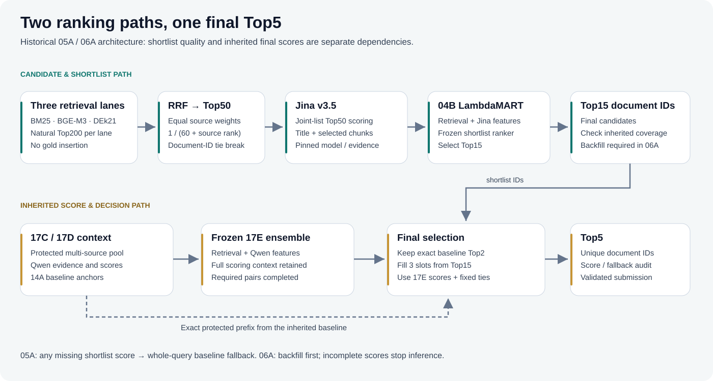

# Vietnamese Legal Retrieval — Giới thiệu tiếng Việt

**Tác giả: [ncat218](https://github.com/ncat218)** · Bối cảnh: UIT DSC 2026 LegalIR

Đây là repo portfolio giới thiệu giải pháp tìm **Top5 văn bản pháp luật tiếng Việt**. Tôi thực hiện notebook cho chuẩn bị dữ liệu, retrieval nhiều nguồn, evidence, reranking/LambdaMART, thí nghiệm và phân tích. Code public được tách thành module để người đọc có thể thử và kiểm tra các quyết định kỹ thuật.

## Luồng chính



BM25, BGE-M3 và DEk21-v2 tạo candidate; RRF hợp nhất Top50. Jina chấm chung Top50, LambdaMART chọn Top15. Bước cuối giữ Top2 baseline và chọn thêm ba document bằng điểm 17E đã đóng băng. 05A fallback toàn query khi thiếu điểm; 06A bổ sung điểm Qwen/feature trước khi xếp hạng.

**Public Recall@5 lịch sử được báo: 0.933833334** cho nhánh 05A/06A. Baseline 17E được đính chính là 0.9332, ở độ chính xác làm tròn. Đây là kết quả lịch sử do chủ dự án cung cấp; demo trong repo không tái lập điểm đó và không phải một lần thi mới.

## Thử ngay

```bash
python -m pip install -e .
legalir demo --query "người lao động chấm dứt hợp đồng"
legalir replay --input examples/replay_input.jsonl --mode 06a_strict --output outputs/replay-001
python -m unittest discover -s tests -v
```

Demo BM25 chạy CPU trên 18 văn bản **giả lập**, không có giá trị tư vấn pháp luật. Replay dùng score giả lập để kiểm tra policy cuối. Có thêm trainer LightGBM thật với OOF theo nhóm trùng lặp; feature mẫu vẫn là dữ liệu tổng hợp.

## Đọc theo mục đích

- [README chính](../README.md): tóm tắt, kết quả, quickstart và đóng góp.
- [Solution write-up](solution.md): bài toán, kiến trúc, so sánh thí nghiệm và giới hạn.
- [Kết quả và provenance](../results/README.md): tách public lịch sử với internal đã kiểm tra artifact.
- [Cách chạy và tái lập](reproduce.md): schema, lệnh chạy, dependency và phần chưa khôi phục end-to-end.

Repo public chỉ có code, hình sơ đồ, số liệu aggregate và ví dụ tự tạo. Dữ liệu cuộc thi, nhãn, submission thật, model weights và toàn bộ notebook nghiên cứu vẫn được lưu riêng.
